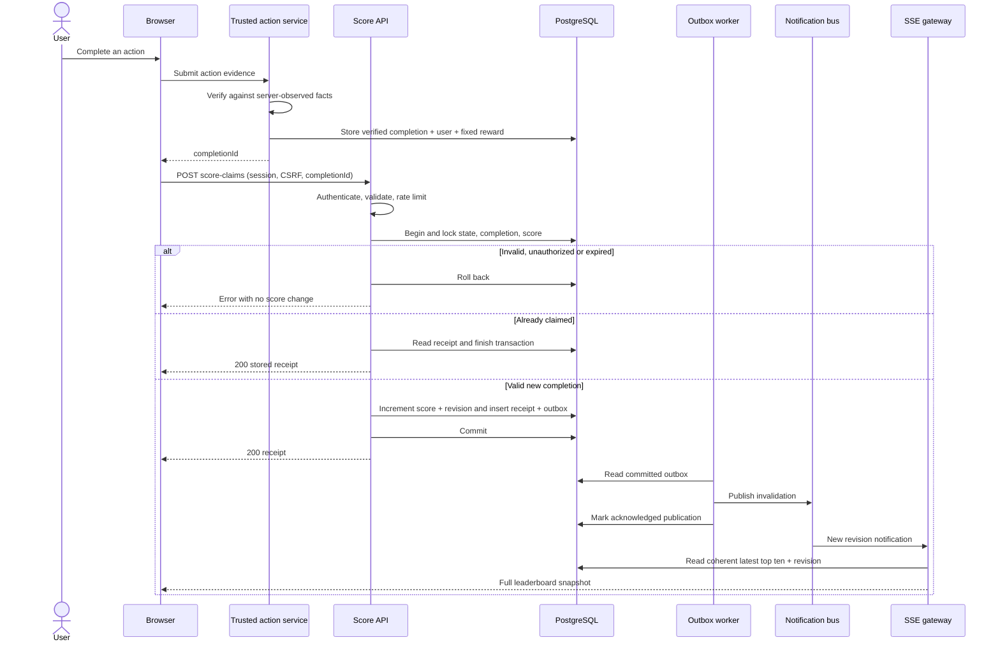

# Authorized score updates and live leaderboard

## Scope and decisions

Implement a backend module that accepts verified action completions, increases scores exactly once per completion, and broadcasts the top ten users. The browser is untrusted. An authenticated user is not automatically authorized to award themselves points.

Assumptions to confirm with the action-owning team:

- An existing identity service provides a secure user session. Identity is read from that session, never from a request's `userId`.
- A trusted action service can verify completion using server-observed evidence. The action itself is outside this module, but this verification contract is mandatory. A browser saying “completed” is insufficient.
- A single global, all-time leaderboard is required. Each action has a server-configured positive integer reward. No client-supplied delta is accepted.
- Only eligible, non-suspended users appear. Rank is score descending, then immutable user ID ascending for deterministic ties. Return fewer than ten entries if fewer users qualify; zero-score users are excluded.
- Scores use PostgreSQL BIGINT constrained to nonnegative values. Serialize scores and revisions as decimal strings to avoid JavaScript precision loss.
- Target: committed updates visible to connected clients within two seconds at p95 under agreed load. This is a target to measure, not an implemented guarantee.

## Boundaries and trust

The action service writes a durable completion record via an authenticated internal interface (mTLS/service identity with a narrowly scoped permission). That record binds an opaque completion ID to a user, action type, server-determined award, reward-rule version, verified completion time and claim expiry. The public client receives only the ID after successful verification. Public clients cannot create, modify or verify these records.

The browser then calls the score API with the completion ID. The score module checks ownership, verification, expiry and eligibility. A stolen ID is unusable by another user. Reusing a previously credited ID returns the stored receipt without increasing the score, even after its expiry. Expiry is checked only for a new claim. Authorization and suspension rules still apply to retries.

If the action service cannot produce trustworthy evidence, prevent launch of score awards for that action; rate limiting, obscured endpoints or client-side checks cannot establish that an action occurred.

## API contract

All public endpoints use HTTPS. This design uses a same-origin Secure, HttpOnly, SameSite session cookie. POST requires a session-bound CSRF token and allowed Origin. Read and stream endpoints require an authenticated session, but expose only public profile fields. Restrict CORS to the configured application origin. No authentication credentials in query strings.

### `POST /v1/score-claims`

Body: `{ "completionId": "<UUID>" }`. Reject unknown fields including `score`, `delta`, `userId`, and `actionType`. Limit body size to 2 KiB. The completion ID is the idempotency key; another independently generated request key must not bypass uniqueness.

Success, HTTP 200 (both first claim and retry):

```json
{
  "completionId": "9f79b4e5-017f-4a86-a31b-674893b83f16",
  "awardedPoints": "10",
  "scoreAfterClaim": "120",
  "revision": "42"
}
```

Persist and return this receipt unchanged on retries. `scoreAfterClaim` is the score immediately following that particular claim; later claims may have increased the user's current score. The receipt revision is a committed leaderboard revision, not proof that delivery has already reached every subscriber.

| Status | Stable error code | Meaning |
| --- | --- | --- |
| 400 | `INVALID_REQUEST` | Invalid JSON, ID or fields |
| 401 | `UNAUTHENTICATED` | Missing/expired session |
| 403 | `FORBIDDEN` | Failed CSRF/Origin, suspended user |
| 404 | `COMPLETION_NOT_FOUND` | Missing completion or owned by another user; do not leak existence |
| 409 | `COMPLETION_NOT_READY` | Verification pending; no award |
| 409 | `SCORE_LIMIT_REACHED` | Increment would exceed supported range |
| 410 | `COMPLETION_EXPIRED` | Verified but unclaimed completion expired |
| 413 | `BODY_TOO_LARGE` | Request over the body limit |
| 429 | `RATE_LIMITED` | Retry after the supplied `Retry-After` interval |
| 503 | `TEMPORARILY_UNAVAILABLE` | No success acknowledged; retry same completion ID |

Errors use `{ "error": { "code": "...", "message": "..." }, "requestId": "..." }` without internal details. Invalid verification is treated as not ready or rejected according to the action service state, never as an award.

### `GET /v1/leaderboard`

Returns a coherent snapshot with `Cache-Control: no-store`:

```json
{
  "revision": "42",
  "entries": [
    { "rank": 1, "userId": "<UUID>", "displayName": "Alex", "score": "120" }
  ]
}
```

No email addresses or private profile data. Render display names as text on the frontend. The query and revision must come from the same PostgreSQL repeatable-read snapshot.

### `GET /v1/leaderboard/stream`

Server-Sent Events (SSE) is sufficient for server-to-browser updates. Authenticate the cookie before opening the stream. Set `Content-Type: text/event-stream`, `Cache-Control: no-cache, no-transform`; disable proxy buffering and send a heartbeat comment every 15 seconds.

```text
id: 42
event: leaderboard
data: {"revision":"42","entries":[...]}

```

Each event is a **full top-ten snapshot**, not a delta. On connection or reconnect, always send the latest coherent snapshot. `Last-Event-ID` need not be replayed because a full snapshot replaces prior state; missing intermediate revisions is safe. Clients accept only newer revisions using arbitrary-precision integer comparison, never lexicographic or JavaScript Number comparison. The first snapshot is accepted unconditionally.

To avoid the subscribe/snapshot race, a gateway first registers for notifications and buffers them, then reads/sends a snapshot, then processes buffered newer revisions. Notifications are invalidation signals; the gateway reads the latest coherent database snapshot. Additionally refresh active streams every five seconds so a lost pub/sub signal cannot leave them stale indefinitely. Coalesce rapid notifications, retaining the newest revision. Bound each client's queue; close slow connections and let them reconnect for a fresh snapshot. Disconnect at session expiry and revalidate long-lived sessions periodically for revocation.

## Persistent data model

PostgreSQL is authoritative. Redis may distribute invalidations between gateway replicas; it is not the source of score truth.

| Table | Required fields / constraints |
| --- | --- |
| `action_completions` | `id` UUID PK, `user_id` FK, `action_type`, `reward_points` BIGINT > 0, `rule_version`, `verification_status`, `completed_at`, `expires_at`; written by trusted verifier |
| `user_scores` | `user_id` PK/FK, `score` BIGINT >= 0, `eligible` boolean; initialized at account creation |
| `score_claims` | `completion_id` PK/FK, `user_id`, `awarded_points`, `score_after_claim`, `revision`, `claimed_at`; immutable audit and idempotency receipt |
| `leaderboard_state` | singleton row, `revision` BIGINT >= 0 |
| `outbox` | `id` PK, unique `revision`, `event_type`, `created_at`, `published_at` nullable, retry metadata |

Partial ranking index: `(score DESC, user_id ASC) WHERE eligible AND score > 0`. Index claim history by `(user_id, claimed_at DESC)`. Completion identity and award become immutable once verified. Display-name or eligibility changes must use the same revision/outbox protocol because they change visible snapshots.

## Transaction algorithm

1. Authenticate, check CSRF/Origin, validate shape and apply per-user/IP rate limits. Use an initial example policy of 30 claims/minute/user with burst 10, configurable by action behavior; retries also consume rate budget. Limit concurrent SSE sessions per user.
2. Begin a database transaction. Lock the singleton `leaderboard_state` row with `FOR UPDATE`. This intentionally serializes scoreboard mutations and gives revisions a committed total order; a plain sequence alone does not establish commit order. All score/eligibility/profile mutations affecting snapshots must obey this protocol.
3. Lock the completion record with `FOR UPDATE`. Check user ownership. Read authoritative user eligibility under the same mutation protocol; reject a suspended account. If a receipt already exists, return it without changing state.
4. Require verified status and an unexpired completion using server/database time. Reward comes from the immutable verified record, never the request. Lock the user's score row. Check overflow and per-action award policy.
5. Increment with `UPDATE user_scores SET score = score + :reward ... RETURNING score`. Increment the singleton revision. Insert the immutable receipt and outbox invalidation in the same transaction. A UNIQUE constraint on completion ID remains a second line of defense against duplicate awards.
6. Commit before returning HTTP 200. Any failure rolls back the score, receipt, revision and outbox together. Bound lock/statement timeouts; on deadlock/serialization failure retry a small bounded number of times, then return 503 with a retry hint.
7. An outbox worker reads committed rows, publishes invalidations, and marks them delivered only after broker acknowledgment. Use a lease or `FOR UPDATE SKIP LOCKED` for multiple workers. Crashing after publication can cause duplicates; gateways and clients ignore old revisions. Retry publication with bounded backoff; alert on backlog age. Never delete undelivered records on a retry limit.

Lock order is always state → completion → score. The verifier must not call back into the score service while holding completion locks. There is no external network verification inside the score transaction; verification evidence is already stored.

## Execution flow



## Reliability and abuse controls

- A lost HTTP response is retried with the same completion ID; it returns the original receipt. Concurrent duplicate requests award only once. Distinct completions both apply without lost updates.
- A database outage returns 503, never a speculative success. An unavailable broker does not lose awards: committed outbox rows are retried and clients can refresh snapshots.
- Validate the action's frequency and eligibility in the trusted verifier; otherwise an attacker can farm unlimited legitimately issued completions. Detect suspicious reward velocity separately from ordinary API rate limits.
- Deny direct public access to verifier endpoints and database writes. Restrict service roles: verifier creates completions; score service claims and awards; gateways read public rankings; worker manages outbox delivery.
- Record request IDs, completion IDs, result codes, award/revision and actor identity in audit logs, but no session tokens. Keep receipts at least as long as completions could be replayed; do not prune uniqueness records while a completion remains claimable.
- Monitor rejected/replayed claims, transaction latency, lock waits, outbox backlog/age, connection counts, reconnects and commit-to-client latency. Reconcile aggregate scores against the immutable claim ledger.

## Acceptance criteria

1. Seed more than ten users, including ties and suspended accounts; GET and SSE return the same deterministic eligible top ten.
2. A verified completion increments exactly its configured award. A forged body delta, unknown completion, another user's completion, pending verification and expiry cause no changes.
3. Send 100 concurrent requests for one completion: exactly one ledger entry and one increment, with identical success receipts. Send distinct completions for one user: all increments are retained.
4. Simulate crashes before commit, after commit/before response, before publication, and after publication/before acknowledgment. Verify no lost or duplicated award and eventual live convergence.
5. Disconnect during an update, reconnect with an old event ID, reorder/duplicate notifications, and drop pub/sub delivery: the client converges to the newest full snapshot without score regression.
6. Reject CSRF, expired/revoked sessions, oversized bodies and rate-limit excess. Test BIGINT overflow and malicious display names rendered as text.
7. Load test the agreed update/subscriber volume; verify p95 freshness target and bounded queues. During broker failure report degraded freshness while GET remains authoritative.

## Improvements and scaling

The global revision lock is a conscious small-system tradeoff and likely the first write bottleneck. Measure it before introducing distributed ranking. At larger scale, partition leaderboards by competition/season, use a durable event log and a materialized ranking projection with explicitly defined ordering and lag. A Redis sorted set can accelerate rankings, but tie ordering and precision need a design compatible with BIGINT (Redis scores are floating-point); do not blindly store arbitrary BIGINT values as sorted-set scores.

Future score corrections should append compensating audited ledger entries, with an administrator-only authorization policy, rather than editing historical claims. Add seasons, private profiles, retention and appeal rules only after product decisions. This document is a specification; no score service is deployed by this submission.
